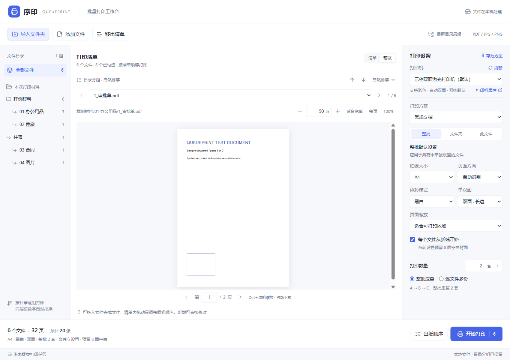
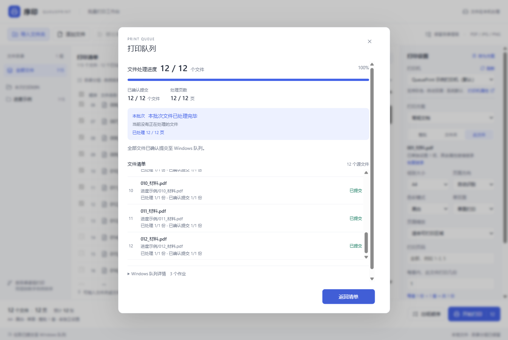

<div align="center">


# 序印 · QueuePrint

**把一整批材料，按目录、按顺序打好。**

面向 Windows 的本地批量打印工具。混合导入 PDF 与图片，保留子文件夹分组，核对顺序后一次提交。

[](https://github.com/Mechanic707/QueuePrint/releases)
[](#安装与启动)
[](LICENSE)
[](#测试与验证)
[](https://github.com/Mechanic707/QueuePrint/actions/workflows/ci.yml)

[**下载 Windows 版**](https://github.com/Mechanic707/QueuePrint/releases/latest) · [快速开始](#快速开始) · [功能一览](#功能一览) · [开发与构建](#开发与构建) · [提交问题](https://github.com/Mechanic707/QueuePrint/issues)


<sub>截图使用自建材料与演示打印机，文件与设备名称均为示例。</sub>

</div>

## 为什么做序印

一批材料常常分散在多个子文件夹中：审批单、合同、发票、付款凭证和图片附件，需要按组打印，部分文件还要额外多印几份。

序印把这件事放到同一个工作台里：**左侧看目录，中间核对最终清单，右侧设置打印属性**。文件夹分组、文件份数、整批套数与双面边界都能在提交前确认。

## 功能一览

| 能力 | 当前版本 |
| --- | --- |
| 混合格式 | 同一清单导入 PDF、JPG/JPEG、PNG |
| 文件夹批量导入 | 递归读取子目录，保留根目录与层级分组 |
| 资源管理器拖放 | 直接拖入一个或多个文件夹、文件，也可混合拖入 |
| 去重与导入提示 | 重复路径去重，合并重叠的父子目录选择；显示跳过格式及读取问题 |
| 稳定顺序 | 本级文件在前、子目录在后；同层按 `1、2、10` 自然排序 |
| 手动调整 | 文件在组内排序，文件夹在同级整组移动 |
| 单文件多份 | 清单内直接编辑份数，范围为 1–100 |
| 成套与逐文件打印 | 支持“整批成套”和“逐文件多份”，明确展示份数乘法与最终顺序 |
| 打印机与常用属性 | 选择 Windows 打印队列，设置纸张、方向、色彩、单双面和缩放 |
| 三级设置范围 | 整批 → 文件夹 → 单文件逐项继承，可恢复上级设置 |
| 厂家高级属性 | 打开真实驱动属性窗口，保留纸盒等驱动私有设置 |
| 内容预览 | 在预览中切换文件与页码，输入缩放比例、Ctrl＋滚轮缩放与拖拽查看 |
| PDF 页码范围 | 例如 `1-3, 5`，按所选页面生成打印计划 |
| 双面文件边界 | 默认每个文件从新纸开始，按需预留空白背面，每套独立起纸 |
| 提交控制 | 打印前确认，按序提交，暂停或停止后续任务 |
| 文件级进度 | 按文件显示处理与确认提交进度，查看当前文件、页数及多份进度 |
| 常用方案 | 保存整批打印属性及文件边界规则 |
| 本地处理 | 文档读取、预览和打印均在本机完成，源文件保持原样 |

<details>
<summary><strong>查看文件夹拖放与内容预览</strong></summary>

### 从资源管理器拖入整批材料


### 打印前核对 PDF 内容



</details>

## 安装与启动

在 [Releases](https://github.com/Mechanic707/QueuePrint/releases/latest) 下载 Windows x64 免安装包：

```text
QueuePrint-0.1.5-win-x64.exe
```

打开即可使用。发布包已包含 Electron、本地打印助手及所需 .NET 运行时，使用软件无需安装 Node.js 或 .NET SDK。打印机需要先在 Windows 中安装相应驱动。

| 下载项 | 说明 |
| --- | --- |
| [QueuePrint-0.1.5-win-x64.exe](https://github.com/Mechanic707/QueuePrint/releases/download/v0.1.5/QueuePrint-0.1.5-win-x64.exe) | Windows x64 免安装程序 |
| [SHA256SUMS.txt](https://github.com/Mechanic707/QueuePrint/releases/download/v0.1.5/SHA256SUMS.txt) | 发行文件的 SHA-256 校验值 |

当前发行包未做代码签名，可通过 `Get-FileHash .\QueuePrint-0.1.5-win-x64.exe -Algorithm SHA256` 核对发布页中的校验值。

如使用目录版，运行 `win-unpacked/序印 QueuePrint.exe`，并保留整个 `win-unpacked` 目录。升级时先关闭旧版本，再运行新版本。

## 快速开始

1. **导入材料**：点击“导入文件夹”或“添加文件”，也可从资源管理器直接拖入文件夹与文件。
2. **核对清单**：检查目录分组、勾选范围、页数与顺序。清单中的顺序就是软件提交任务的顺序。
3. **设置份数**：需要额外份数的文件，直接修改对应行的“份/套”；右侧设置整批套数。
4. **选择打印机**：设置纸张、方向、黑白/彩色、单双面与缩放。纸张及能力选项来自当前驱动。
5. **查看出纸顺序**：逐项核对套数、每文件份数与双面边界。
6. **确认并打印**：点击“开始打印”，核对确认窗口，再点击“确认并打印”提交到真实打印机。

勾选决定文件是否打印；点击文件决定查看谁的属性。修改某个文件的份数或预览内容，不会自动改变它的勾选状态。

## 预览、缩放与切换文件

- **切换文件**：预览顶部的文件选择器按清单顺序分组显示文件，也可点击“上一文件／下一文件”。点击左侧其他文件夹，会预览其中的首个文件。
- **切换页面**：使用上一页／下一页按钮，或直接输入 PDF 页码。图片按一页预览。
- **自由缩放**：输入 `10%–400%` 之间的比例，使用放大／缩小按钮，或在内容上按住 **Ctrl＋滚轮**缩放。
- **适应窗口**：一键切换适合宽度、适合整页和 100%。适应模式会随窗口大小更新。
- **查看局部**：放大后按住鼠标左键拖拽内容，或使用滚动条移动查看。

预览操作只改变查看方式，不修改打印勾选、份数、打印页码或右侧的打印缩放设置。PDF 与图片切换、快速连续缩放会取消旧任务；同路径文件更新并重新导入后会刷新预览缓存。大页面使用受限的预览栅格分辨率，保持请求的显示尺寸，并在需要时显示清晰度提示。

## 文件夹与排序规则

例如导入下面的目录：

```text
材料/
├─ 0_说明.pdf
├─ 01_采购/
│  ├─ 1_合同.pdf
│  ├─ 2_发票.png
│  └─ 10_附件.pdf
└─ 02_差旅/
   └─ 1_行程.pdf
```

默认顺序为：

```text
0_说明.pdf
→ 01_采购/1_合同.pdf
→ 01_采购/2_发票.png
→ 01_采购/10_附件.pdf
→ 02_差旅/1_行程.pdf
```

规则如下：

- **保留目录分组**：先处理当前目录中的文件，再依次进入子目录。
- **同层自然排序**：数字按数值比较，`2` 排在 `10` 前面；不会把所有子目录文件按文件名混排。
- **手动排序保留边界**：文件在所属目录内移动；目录在同级整组移动。
- **混合拖入会去重**：同一次拖入父目录、子目录和其中的文件时，重叠部分只读取一次。再次导入已有文件时保留清单中的独立设置与勾选范围。
- **同名根目录可区分**：不同位置的同名目录会获得区分标签，例如 `材料`、`材料 (2)`。

清单顺序控制本软件的提交顺序。共享打印机中的其他作业、设备的正反序出纸和纸堆朝向，也会影响最终纸堆排列。

## 单文件份数与整批套数

### 一个文件打印多份

在清单内，把 A 的份数设为 `3`，B 保持 `1`，整批为 `1` 套：

```text
A → A → A → B
```

点击该文件后，右侧会切换到“此文件”，可继续设置页码范围和独立打印属性。

### 整批打印两套

保持 A 为 `3` 份、B 为 `1` 份，将整批数量设为 `2` 套：

```text
第 1 套：A → A → A → B
第 2 套：A → A → A → B
```

| 文件 | 每套内份数 | 整批套数 | 实际总份数 |
| --- | ---: | ---: | ---: |
| A | 3 | 2 | 6 |
| B | 1 | 2 | 2 |

**实际总份数 = 此文件每套内份数 × 整批套数。** 右侧提示与“出纸顺序”会同步更新；顺序列表标明“第几套”和“本文件第几份”。

### 逐文件多份

切换到“逐文件多份”后，列名变为“基础份数”。仍以 A 的基础份数为 `3`、B 为 `1`、全局数量为 `2` 为例：

```text
A → A → A → A → A → A → B → B
```

此时，**实际总份数 = 本行基础份数 × 全局份数**。两种模式的总数量可以相同，输出顺序不同。

## 打印属性与双面边界

### 设置的应用范围

| 范围 | 应用对象 | 继承规则 |
| --- | --- | --- |
| 整批 | 当前批次的默认属性 | 作为所有文件的基础设置 |
| 文件夹 | 当前目录及其子目录 | 只覆盖改动的属性，其余继承上级 |
| 此文件 | 当前文件 | 优先采用单文件设置，其余继续继承 |

例如：整批设为黑白双面，某个文件夹改成彩色，该文件夹中的一个文件再改成单面。这个文件最终为**彩色单面**，纸型与缩放继续沿用上级。点击“恢复继承”即可移除当前范围的独立设置。

“打印机属性”打开当前打印机的驱动窗口。返回的属性副本只用于序印任务，不修改 Windows 全局默认值。纸盒、装订等选项的实际能力由驱动提供。

### 双面时，每份文件从哪里开始？

默认开启“每个文件从新纸开始”。例如 A 有 3 页、B 有 2 页：

```text
纸张 1：A 第 1 页 / A 第 2 页
纸张 2：A 第 3 页 / 空白背面
纸张 3：B 第 1 页 / B 第 2 页
```

关闭该选项后，相同属性的连续文件可以接着使用背面。每套仍独立起纸，明确的多份副本也保持独立起始。页数、预计用纸和空白背面数量会随计划更新。

相邻且属性相同的内容会组成一个 Windows 作业；属性变化或进入下一套时建立新作业。程序保留原顺序，不按打印属性重新排列文件。

## 打印状态与任务控制

队列窗口以**文件数量**显示处理进度。比如 12 个文件合并为 1 个 Windows 作业时，主进度仍按 `0 / 12 个文件` 更新；当前文件会显示名称、内容页数和第几份。存在多份或多套时，额外显示已处理份次。

同一文件的全部计划份次处理完，才计为 1 个“已处理文件”；所属 Windows 作业获得回执后，才计入“已确认提交”。Windows 作业编号与技术名称放在可展开的详情中。逐文件列表显示前 100 个文件，整体计数与当前文件覆盖全部清单。



| 界面状态或操作 | 含义 |
| --- | --- |
| 已处理 | 对应文件的全部份次已完成绘制处理，尚不代表 Windows 已接收 |
| 已处理，待提交确认 | 文件处理完成，等待所属 Windows 作业的提交回执 |
| 已确认提交 | 对应文件的全部计划份次均已获得提交确认 |
| 正在准备／有序提交 | 验证文件及设置，按计划向 Windows 队列提交 |
| 暂停后续 | 等当前作业提交结束后暂停，阻止下一个作业提交 |
| 继续提交 | 继续处理已暂停批次中的后续作业 |
| 停止后续 | 阻止剩余作业提交；已入队的任务可能继续输出 |
| 已提交至 Windows 队列 | Windows 已接收任务，实体出纸情况以打印机为准 |
| 提交失败／状态不明 | 显示错误，保留核对提示，不自动重试不明确的任务 |

**“已提交”与“实际出纸完成”是两个状态。** 在提交异常、设备缺纸或网络打印机断连后，先检查 Windows 队列与已输出材料，再决定重新提交的范围，避免重复打印。

## 本地处理与数据保存

文档在本机读取、预览和打印，程序不调用云端文档转换服务。导入与打印保持源文件原样。

打印方案、偏好和当前打印机属性副本保存在当前 Windows 用户的应用数据目录；导入文件清单保留在当前会话。文件在导入后发生修改时，需要重新导入，以便重新统计页数并生成计划。

## 开发与构建

### 环境

- Windows x64。
- Node.js **24** 与 npm；也支持 `22.13+` 的 22.x 版本。
- **.NET 8 SDK**，用于构建本地打印助手。
- Git，用于获取源码。

依赖版本由 `package-lock.json` 锁定。首次安装依赖、还原 NuGet 与下载打包工具需要网络；发布后的软件在本机处理文档。

### 从源码运行

```powershell
git clone https://github.com/Mechanic707/QueuePrint.git
cd QueuePrint

npm.cmd ci
npm.cmd run native:build
npm.cmd start
```

Windows PowerShell 中使用 `npm.cmd` 可以直接运行命令，避免本机 PowerShell 脚本执行策略对 `npm.ps1` 的影响。

### 构建发布包

```powershell
# 构建／更新本地助手
npm.cmd run native:build

# 生成 Windows 目录版
npm.cmd run pack

# 生成 Windows x64 免安装启动包
npm.cmd run dist
```

构建输出位于 `release/`。`pack` 生成 `win-unpacked/`，`dist` 生成 `QueuePrint-<版本>-win-x64.exe`。两者会先检查原生组件完整性，缺失时停止打包。免安装包打包了本地助手与自包含 .NET 运行时；目录版需要完整保留同目录依赖。

便携版每次启动使用独立解压目录，防止重复启动后的清理影响仍在运行的窗口。当前固定的 electron-builder 26.18.0 通过 `portable.unpackDirName: true` 启用此行为；升级打包工具后应运行下面的便携版回归检查。

### 常用命令

| 命令 | 用途 |
| --- | --- |
| `npm.cmd start` | 启动 Electron 桌面程序 |
| `npm.cmd test` | 运行 Node 自动测试 |
| `npm.cmd run native:build` | 构建自包含 Windows 原生助手 |
| `npm.cmd run pack` | 构建 Windows 目录版 |
| `npm.cmd run dist` | 构建 Windows x64 免安装包 |
| `npm.cmd run qa:portable` | 验证最终便携 EXE 重复启动后原生组件仍可用 |
| `npm.cmd run qa:progress` | 使用模拟进度验证文件级队列界面，不提交打印作业 |
| `npm.cmd run qa:preview` | 检查自由缩放、文件切换、拖拽及预览缓存，不提交打印作业 |
| `npm.cmd run qa:fixtures` | 在 `.qa/fixtures` 创建自建样例文件 |
| `npm.cmd run qa:desktop` | 检查实际 Electron 导入、预览与确认界面 |
| `npm.cmd run qa:enhancements` | 检查资源管理器拖放、去重及单文件多份 |
| `npm.cmd run docs:screenshots` | 使用示例设备和自建文件重新生成文档截图 |

## 测试与验证

当前版本的 **67 项 Node 自动测试**覆盖目录自然排序、同级移动、逐项属性继承、页码范围、份数与套数乘法、双面补白、导入去重、提交互斥、暂停/停止、恢复约束、组件完整性、Windows 路径兼容性、文件级进度，以及预览缩放、指针锚点和栅格像素预算。

```powershell
npm.cmd test
```

桌面检查使用自建文件和隔离偏好目录，验证真实 Electron 程序中的文件夹导入、PDF/图片预览、份数计算、确认窗口、拖放及自由缩放。文件进度检查使用模拟提交回执；各检查均不向打印机提交真实作业。

Playwright 已作为开发依赖锁定，`npm ci` 后即可运行桌面检查，无需额外下载浏览器。检查会启动实际 Electron 窗口；完整确认流程测试需要 Windows 中至少安装一个打印队列，例如系统的虚拟 PDF 打印机。

```powershell
npm.cmd run qa:fixtures
npm.cmd run qa:desktop
npm.cmd run qa:enhancements
npm.cmd run docs:screenshots
```

原生只读、渲染与计划检查：

```powershell
powershell -NoProfile -ExecutionPolicy Bypass -File native/tests/smoke.ps1

# 可选图片扩展检查，测试环境需要 Python 与 Pillow
python -m pip install Pillow
python native/tests/image_smoke.py
```

验证范围为软件逻辑、实际桌面交互与离线渲染，**尚未执行实体打印验证**。首次连接实际设备时，建议先用少量材料核对纸向、双面翻边和输出质量。

### GitHub Actions

- 推送到 `main` 或提交 Pull Request 时，自动运行 Windows Node 测试和原生助手只读检查。
- 推送与 `package.json` 版本一致的 `v*` 标签时，自动构建 Windows 免安装包、生成校验值并上传到 Release。
- 手动触发发布工作流会生成可下载的 Actions 构建产物；已有同名 Release 资产会保留。勾选 `verify_existing` 可只下载当前已发布版本进行回归验证。
- 发布前会对比打包后的源码与全部原生文件，并运行最终便携 EXE 的重复启动回归，避免只验证目录版。

## 项目结构

```text
QueuePrint/
├─ src/
│  ├─ core/          目录树、属性继承、页码与打印计划
│  ├─ main/          文件登记、设备桥、偏好与有序提交
│  └─ renderer/      三栏界面、内容预览与交互
├─ .github/workflows/ Windows 自动检查与发行包构建
├─ native/           Windows/.NET 原生打印助手与 PDFium
├─ test/             核心逻辑测试
├─ test-main/        文件导入与提交队列测试
├─ scripts/          构建、样例生成与桌面检查
├─ assets/           应用图标
├─ docs/images/      项目截图
├─ THIRD-PARTY-NOTICES.md
└─ LICENSE
```

界面将勾选、排序和属性交给核心模块生成明确计划；主进程核对已导入文件并有序提交；原生助手通过 Windows 打印 API 与 PDFium 完成逐页渲染。原生协议与命令说明见 [native/README.md](native/README.md)。

## 更新记录

### v0.1.5

- 预览新增文件选择器、上一文件／下一文件，支持从左侧文件夹直接切换查看。
- 支持自定义 10%–400% 缩放、Ctrl＋滚轮、放大缩小按钮及拖拽平移。
- 新增适合整页，保留适合宽度、100% 和 PDF 页码跳转。
- 修复快速切换 PDF 时复用已销毁缓存、旧任务覆盖当前画面的问题。
- 按文件版本刷新缓存，图片缩放复用已解码内容；限制预览栅格分配，改善大比例缩放的稳定性。

### v0.1.4

- 打印队列主进度按文件显示，多个文件合并成一个 Windows 作业时也能逐个更新。
- 展示当前文件名、内容页数、单文件多份及整批多套的处理份次。
- 区分“已处理”和“已确认提交”，逐文件显示待处理、处理中、待提交、已提交及待核对状态。
- Windows 作业详情默认折叠，更新进度时保留展开与滚动位置。
- 增加文件级进度及中断场景测试，保留原有打印分组、顺序和暂停行为。

### v0.1.3

- 修复 Windows 临时目录盘符或路径大小写变化时，界面请求被误判为无效的问题。
- 在保留窗口和主页面校验的基础上，按 Windows 文件路径语义比较界面地址。
- 发布流程增加小写临时目录下的最终 EXE 回归检查。
- 移除窗口标题中硬编码的旧版本号。

### v0.1.2

- 修复重复打开免安装程序后，临时目录被另一启动进程清理、导致打印组件丢失的问题。
- 每次便携启动使用独立目录；新增最终 EXE 的重复启动回归检查。
- 打包前验证本地打印助手及自包含运行库，避免生成缺组件的发行包。
- 发行版组件缺失时显示重新打开／重新下载提示，开发环境保留构建命令。

### v0.1.1

- 清单新增直接编辑单文件份数的入口，顺序确认标明套号与副本编号。
- 支持从资源管理器拖入文件夹，支持文件与多个文件夹混合导入。
- 重复拖入保留原有份数与勾选；重叠父子目录去重，同名根目录独立分组。
- 增加公开文档截图、使用示例及 Windows 自动检查流程。

## 常见问题

### v0.1.1 显示“本地打印组件尚未构建”怎么办？

请关闭所有序印窗口，下载并运行 **v0.1.3 或更新版本**。新版已修复重复启动时清理组件，以及 Windows 临时路径大小写导致请求失败的问题。使用发行版无需执行 `npm run native:build`；该命令仅供源码开发使用。

### 支持 Word、Excel、PPT 或其他图片格式吗？

当前桌面版本支持 **PDF、JPG/JPEG、PNG**。Office 文档请先导出 PDF，再导入序印。其他扩展名会在导入时跳过。

### 为什么某个 PDF 显示不可打印？

程序会检查页数与打印权限。密码保护、文件损坏、限制打印或读取失败的文件会显示错误并取消勾选；请使用可以正常打开且允许打印的版本重新导入。

### PDF 会保持矢量直通打印吗？

当前管线通过 PDFium 按页栅格化，再交给 Windows GDI 打印，默认 **300 DPI**。大量高分辨率页面会增加处理时间与内存占用。含交互表单的 PDF 请先扁平化，当前打印管线未绘制交互控件层。

### 预览就是最终打印版式吗？

预览展示源文件内容。最终纸张尺寸、方向、缩放、可打印边距和单双面由打印设置及驱动决定。选择“实际大小”时，超出可打印区域的部分可能被裁切。

### 为什么换打印机后纸张或单双面设置改变了？

序印读取新打印机的纸型及彩色、双面能力。原纸型不受支持时，会调整到可用纸型并提示；单面或黑白设备会相应调整能力选项。

### “打印机属性”中的纸盒、装订会生效吗？

序印保留驱动返回的属性副本，实际支持与效果由打印机驱动决定。混合横纵页双面、厂家纸盒和装订选项需要结合实际设备试打。切换设备或更新驱动后，重新打开属性窗口核对设置。

### 虚拟 PDF 打印机为什么弹出保存窗口？

虚拟 PDF/XPS 打印机通常需要指定输出位置，是否弹窗由对应驱动决定。普通实体打印机则按其驱动设置处理作业。

### 关闭软件后，导入清单会保留吗？

当前清单只保留在本次会话。打印方案和偏好会保存，下一次启动可以重新导入材料并使用已保存方案。

### 已提交但没有出纸，可以直接再打印一遍吗？

先检查 Windows 队列、设备状态与已输出材料。任务可能正在设备内部处理，或已部分出纸；核对后再决定重新提交哪些文件。

## 反馈与贡献

欢迎通过 [Issues](https://github.com/Mechanic707/QueuePrint/issues) 提交问题或需求。描述文件格式、目录层级、份数与套数、单双面设置、复现步骤和错误提示；能复现问题的最小样例更便于定位。

提交代码前，请运行 `npm.cmd test`。修改打印计划或提交逻辑时，补充能够证明页面顺序、份数和边界行为的测试。

## 许可证

序印自身代码采用 [MIT License](LICENSE)。Electron、PDF.js、Lucide、.NET、PDFium 等组件遵循各自许可证，分发时保留对应声明与许可文件。详见 [THIRD-PARTY-NOTICES.md](THIRD-PARTY-NOTICES.md) 与原生组件随附许可证。
